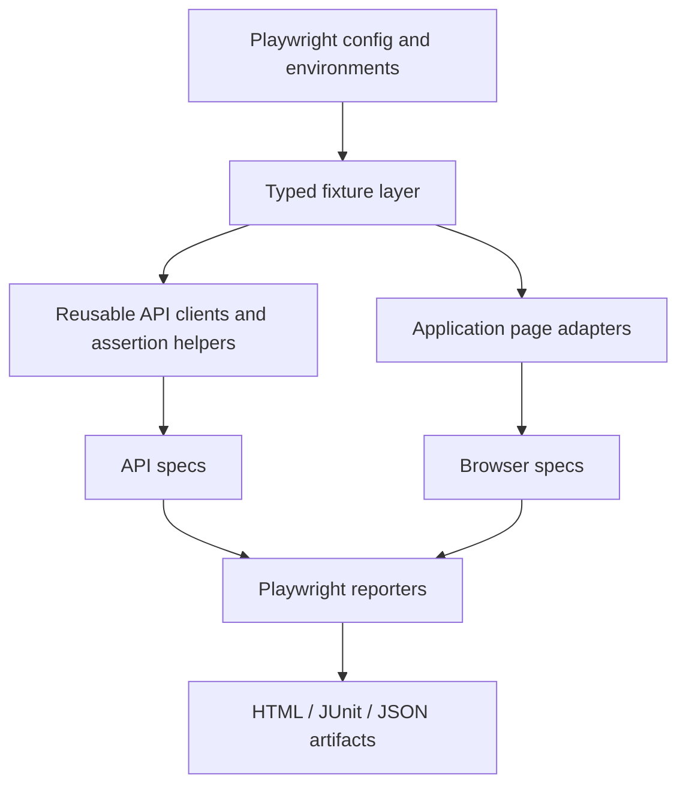

# Architecture

**Boundaries.** Shared code belongs in `src/core`; selectors and business flows belong in an app's `examples/<name>` directory. `playwright.config.ts` controls global execution, but application code should not import configuration files directly. Tests receive `wallet` and `health` via the typed fixture extension, avoiding ad hoc global state.

**Isolation.** Each browser test gets a fresh Playwright context and its own localStorage. API tests use a separately managed request context. Future backend tests must implement test-account provisioning and cleanup.

**Extension roadmap.** Introduce an `ApplicationAdapter` interface when a second real application justifies it; avoid over-engineering abstractions before actual reuse. Mobile drivers and AI providers should be optional integrations, not hard requirements for browser/API tests.
